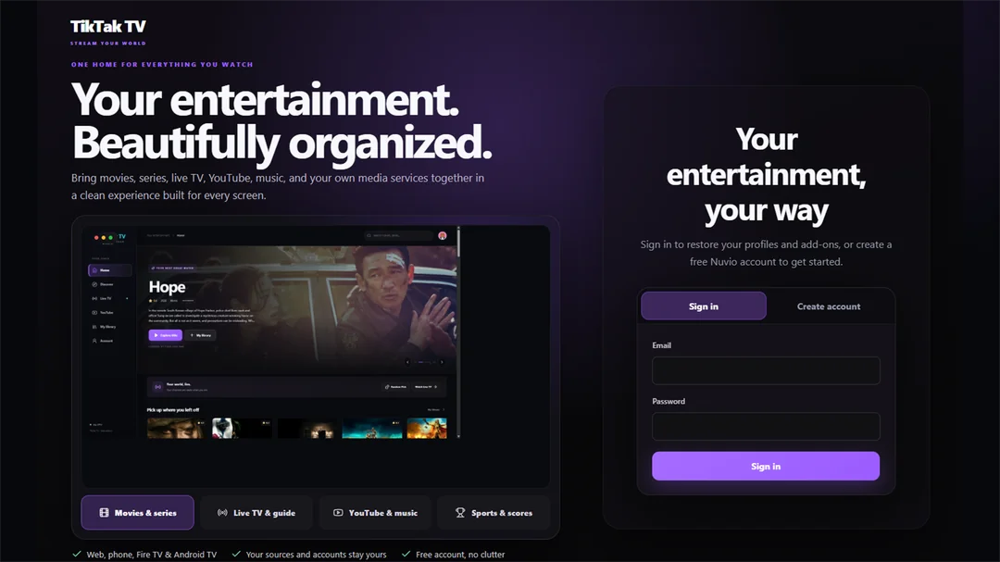
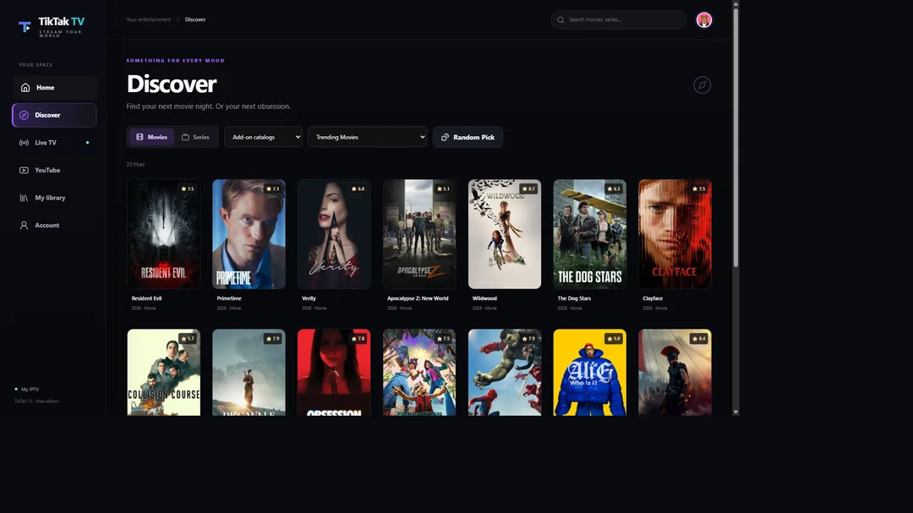
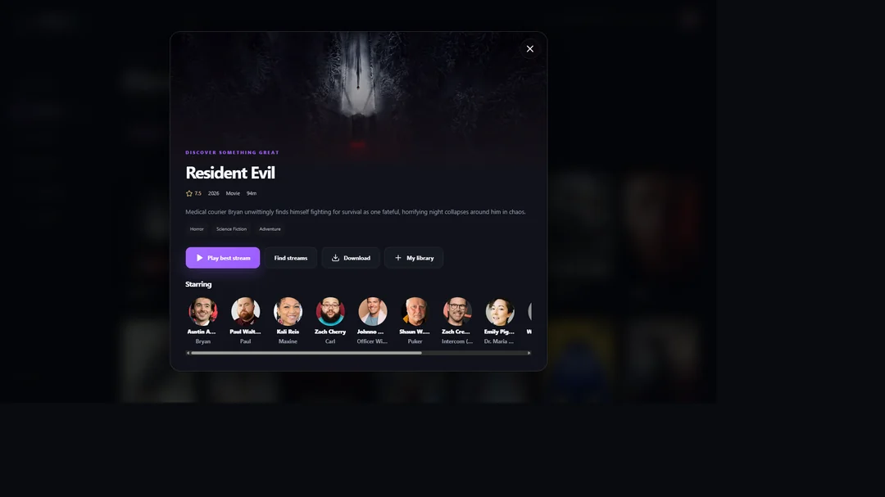
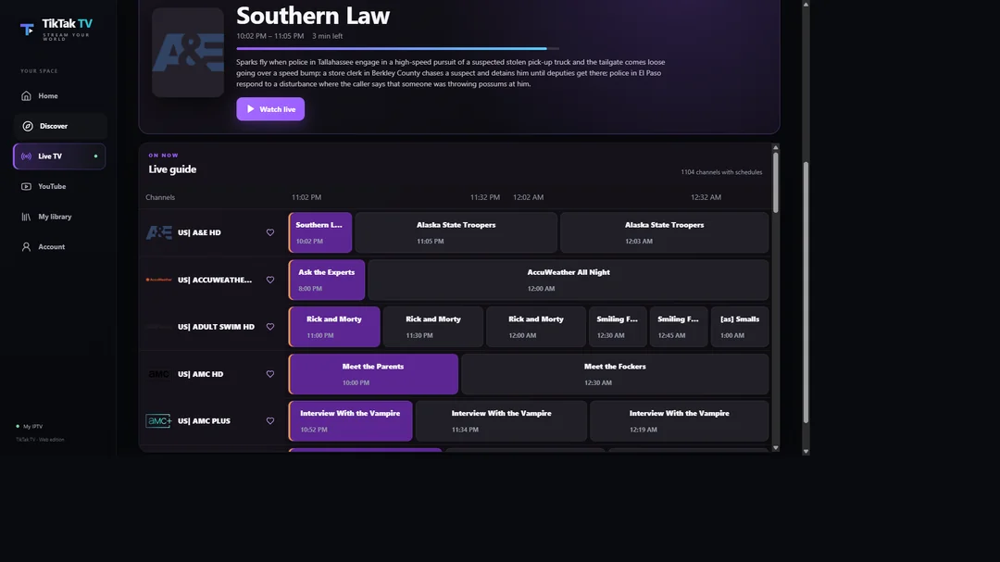
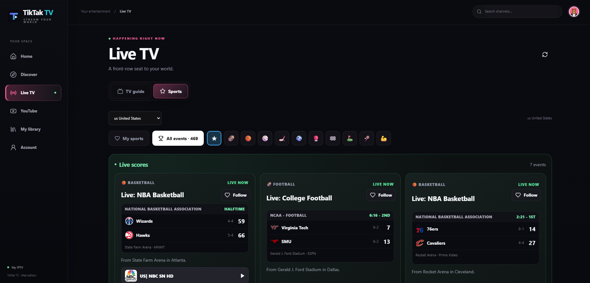
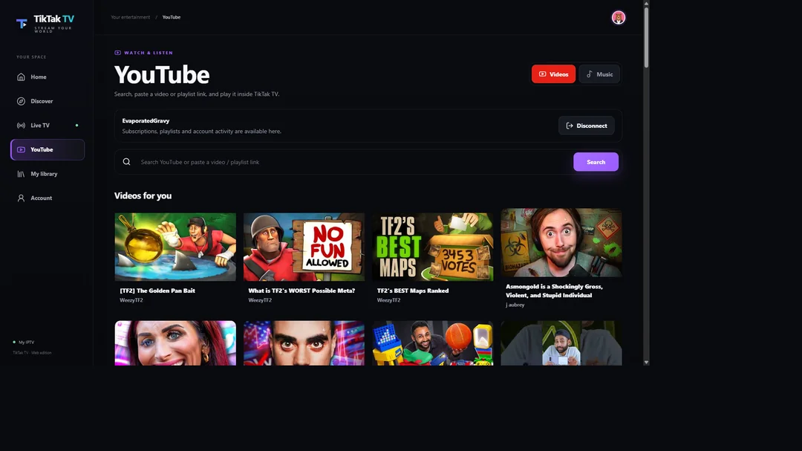
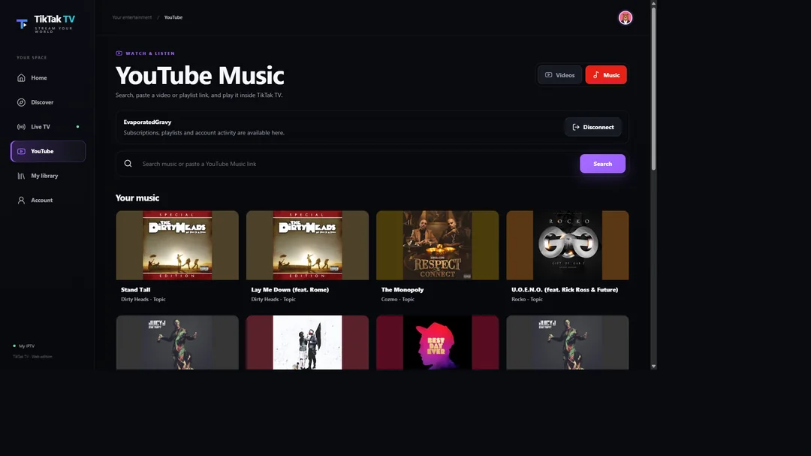

<div align="center">

# TikTak TV

**Your entertainment. Beautifully organized.**

_Movies, shows, Live TV, sports, YouTube, and music — together in one place, on your screens._

[](https://www.tiktaktv.me/)
[](https://github.com/zachgus33/Tik-TakTV/releases)
[](https://github.com/zachgus33/Tik-TakTV/stargazers)
[](LICENSE)

**[Try it on the web](https://www.tiktaktv.me/)** · **[Install on TV](#install-on-fire-tv--android-tv--google-tv)** · **[Features](#what-can-tiktak-tv-do)** · **[Report a bug](#feedback-bug-reports--feature-requests)**



</div>

> [!IMPORTANT]
> **TikTak TV is a free, unofficial community project — not an IPTV provider.** It does not include channels, subscriptions, add-ons, or media. Bring your own compatible services and sources that you are authorized to use.

## One home for everything you watch

TikTak TV is a multi-device entertainment frontend built around the Nuvio ecosystem. It brings the things you already use — your add-on catalogs, movies and series, live television, sports, YouTube, YouTube Music, profiles, and watch progress — into one customizable interface.

Use **the website** on desktop, iPhone, iPad, and Android browsers, or install **the TV app** on Fire TV, Android TV, and Google TV. Configure your setup on the web and use supported account/profile synchronization across devices instead of typing everything with a remote.

### At a glance

|                          | What you get                                                                                               |
| ------------------------ | ---------------------------------------------------------------------------------------------------------- |
| **Movies & series**      | Catalog-powered Home, Discover, search, title details, seasons, episodes, and Continue Watching            |
| **Live TV**              | User-supplied Xtream/M3U services, XMLTV/EPG matching, channel artwork, and a two-hour guide               |
| **Sports**               | Live/upcoming events, scores where available, followed events, and matched channels from _your_ IPTV setup |
| **YouTube & music**      | Separate YouTube and YouTube Music experiences, search, and account-based features where available         |
| **Your library**         | Profiles, collections, favorites, watch progress, and supported Nuvio account/add-on sync                  |
| **TV-friendly controls** | Remote navigation, focus states, compact sidebar, fullscreen playback, and a Live TV mini-player           |
| **Multiple screens**     | Web, installable PWA, Fire TV, Android TV, and Google TV                                                   |

## Take a look around

### Discover movies and shows

Explore catalogs from your installed add-ons, browse curated rows, switch between movies and series, search for titles, and open detailed pages with artwork, descriptions, ratings, cast, and more.

<table>
<tr>
<td width="50%"></td>
<td width="50%"></td>
</tr>
<tr><td align="center"><sub>Discover & browse</sub></td><td align="center"><sub>Title details & playback</sub></td></tr>
</table>

### Live TV that feels like TV

Connect your own IPTV service and use a visual electronic program guide with program descriptions, schedule progress, channel logos, category/country filters, and recently watched channels.

The **Live TV mini-player** can keep the current channel on screen while you browse the guide in TV mode. Restore fullscreen without intentionally restarting the stream, or close the mini-player to stop playback.



### Sports, scores, and your channels

Explore live and upcoming sporting events, filter by sport or country, follow events, and see scores when reliable data is available. TikTak TV can also look for matching channels in **your own IPTV/EPG lineup**.

**Score availability and channel availability are separate:** a missing score doesn't mean an otherwise available IPTV channel can't play.



### YouTube and YouTube Music in one interface

Search videos, browse recommendations, and use the separate Music view without constantly leaving TikTak TV. Supported Google sign-in can surface subscriptions, playlists, and account-related recommendations. Playback uses the YouTube player, with **optional SponsorBlock segment skipping**. On supported TV devices, an **optional SmartTube handoff** is available when SmartTube is installed.

<table>
<tr>
<td width="50%"></td>
<td width="50%"></td>
</tr>
<tr><td align="center"><sub>YouTube videos</sub></td><td align="center"><sub>YouTube Music</sub></td></tr>
</table>

## What can TikTak TV do?

<details>
<summary><strong>Movies, shows & discovery</strong></summary>

- Use compatible Nuvio/Stremio add-ons and their catalogs to populate Home and Discover.
- Browse movies, series, seasons, episodes, metadata, cast, related titles, and recommendations.
- Search and filter catalogs; organize collections/folders and add-on order.
- Track favorites, watch progress, and Continue Watching in supported profiles.
- Choose from available compatible sources, with playback behavior depending on the add-on, source, and device.

</details>

<details>
<summary><strong>IPTV & live television</strong></summary>

- Connect an authorized Xtream or M3U playlist/service.
- Use automatic EPG matching and optional custom XMLTV/EPG links.
- Browse channel categories and countries, program details, artwork, and the two-hour guide.
- Access recently watched channels and TV-focused navigation.
- Continue Live TV in a corner mini-player while browsing the guide (supported TV mode).

</details>

<details>
<summary><strong>Sports</strong></summary>

- Browse live and upcoming games/events, with country and sport filters.
- View scoreboards and event information when reliable data is available.
- Follow events and see matched IPTV channels from your lineup.
- Keep playable-channel matching independent of score availability.

</details>

<details>
<summary><strong>YouTube, music & playback</strong></summary>

- Browse separate YouTube Videos and YouTube Music sections.
- Search for videos, music, and supported playlists; use connected-account features where available.
- Use an optional SmartTube launch/handoff on compatible Android TV hardware.
- Playback features vary by platform and source; supported experiences include subtitles and timing controls, seek, fullscreen, picture-in-picture, and AirPlay on compatible browsers/devices.

</details>

<details>
<summary><strong>Profiles, customization & sharing</strong></summary>

- Sign in and use supported Nuvio profiles, add-ons, collections, and progress sync.
- Customize library organization, catalogs, and viewing preferences.
- Use friend-code features for sharing trusted setup information without posting credentials publicly.
- Use compatible backup/import/export workflows for your setup.
- Configure on the web and pick up supported settings on TV.

</details>

<details>
<summary><strong>TV experience & updates</strong></summary>

- Remote/D-pad navigation, visible focus indicators, and improved TV layouts.
- Sidebar that stays compact and expands when focused.
- Player controls designed to auto-hide during playback.
- Signed Android TV APK with update checking and installation over an existing compatible release.
- What's New messages, release history, and in-app feedback requests.

</details>

## Get started

### Use TikTak TV in a browser

**Open [tiktaktv.me](https://www.tiktaktv.me/)**, sign in or create an account, choose a profile, and connect the compatible services and add-ons you want to use.

- **Windows, macOS, Linux:** Open the site in a modern browser.
- **iPhone / iPad:** Open it in Safari, then use **Share → Add to Home Screen** for an app-like shortcut.
- **Android phones / tablets:** Open it in your browser and use **Install app** or **Add to Home screen** when available.

The web experience can also be installed as a Progressive Web App (PWA) where the browser supports it.

### Install on Fire TV / Android TV / Google TV

The TV edition is distributed as a sideloadable Android APK. **Downloader code: `2564237`**.

1. Install and open **Downloader by AFTVnews** on your TV device.
2. In Downloader, enter **`2564237`** and press **Go**.
3. Follow the redirect to download the official TikTak TV APK.
4. If your device prompts you, allow Downloader to install unknown apps, then install the APK.
5. Launch TikTak TV, sign in, choose your profile, and connect or sync your own services.

**Other ways to install:**

- **[Official GitHub releases](https://github.com/zachgus33/Tik-TakTV/releases)**
- **[Direct signed TV APK](https://github.com/zachgus33/Tik-TakTV/releases/download/tv-latest/tiktak-tv-android-tv.apk)**
- **[TV install and update documentation](tvApp/README.md)**

> [!TIP]
> The web interface can update without rebuilding the TV app. When the APK itself changes, use the built-in update checking or the official signed release. Don't uninstall the app just to check for updates; uninstalling can remove local data.

### Platform support

| Platform               | How to use TikTak TV         | Notes                                                                  |
| ---------------------- | ---------------------------- | ---------------------------------------------------------------------- |
| Desktop / laptop       | Website                      | Current Chrome, Firefox, Edge, Safari and similar modern browsers      |
| iPhone / iPad          | Website / Add to Home Screen | Web/PWA experience; **native iOS IPA is not released**                 |
| Android phone / tablet | Website / PWA                | Browser-based experience                                               |
| Fire TV / Firestick    | TV APK                       | D-pad/remote-first interface                                           |
| Android TV / Google TV | TV APK                       | Remote-first interface; performance and codec support depend on device |

## What's new in the 0.3.6 TV update?

The [current signed TV release](https://github.com/zachgus33/Tik-TakTV/releases/tag/tv-latest) includes:

- **Every compatible movie and episode source remains selectable** in the player, even when it is outside the smaller automatic fallback set.
- **Clearer add-on search progress** names each eligible add-on that responded, failed, or was temporarily paused without exposing private add-on addresses.
- **Audio-aware playback selection and conversion** improves handling of sources whose original audio format is not supported by the device.
- **Broader older-TV compatibility** with a Chromium 69-compatible web bundle for Android 9 televisions.
- **A diagnosable TV startup screen** with retry controls and the installed WebView version instead of leaving the screen blank when startup fails.
- **More accurate production monitoring** recognizes the visible startup fallback while continuing to check built assets, companion health, account access, source discovery, and playback preparation.
- **Configurable SponsorBlock controls** are available in the YouTube player and under **Settings → Playback**, including separate choices for sponsors, self-promotion, interaction reminders, intros, outros, previews, and non-music sections.
- **Optional continuous play for YouTube and YouTube Music** advances through the current results, recommendations, or playlist when an item ends. Autoplay is enabled by default and can be changed in the player or under **Settings → Playback**.
- **More reliable YouTube Music playback** filters uploads that disallow embedding, automatically tries another available track when a saved recommendation becomes unavailable, and offers a clear YouTube/SmartTube fallback when needed.
- The 0.3.5 features remain included: **Live TV mini-player, refreshed EPG, Sports and scores, compact TV navigation, SmartTube handoff, in-app feedback, and responsive layouts.**

The shared web interface also gives the private owner dashboard **versioned analytics definitions**, returned/eligible retention counts, and explicit explanations of sessions, returning accounts, device IDs, platform windows, and visits. It now separates heartbeat-observed UI session time from privacy-safe playback engagement: aggregate player opens, successful starts, final errors, sessions that reached playback, and playing-time buckets by app type/release. Titles, channels, searches, source URLs, credentials, and per-account viewing histories are never included. Users can disable usage analytics under **Settings → Privacy & status**.

Navigation now uses a slimmer, always-visible sidebar on desktop, a compact rail that expands only while it has remote focus on TV, and the existing bottom navigation on phones. This gives content more room without hiding touch or remote controls.

YouTube autoplay and SponsorBlock behavior can now be changed without leaving the player, and the same choices are available under **Settings → Playback**. Music search excludes uploads that YouTube marks as non-embeddable; if a previously saved recommendation later becomes unavailable, TikTak TV tries the next available track and keeps an explicit external-playback option.

These are shipped features, not a claim that every TV model or stream works perfectly. **Real-device testing and feedback are very welcome.** The earlier [0.3.5 community announcement](https://www.reddit.com/r/AndroidTVApps/comments/1xoy0kq/updatetesters_wanted_tiktak_tv_035_live_tv/) remains available for its original testing discussion. Check [Releases](https://github.com/zachgus33/Tik-TakTV/releases) for the current downloadable build.

### Native Android TV development

A dedicated native Android TV client is now under active development. The side-by-side preview reuses the repository's native Kotlin/Compose account, profile, catalog, Live TV, library, sync, and Media3/MPV playback stack. Its ten-foot shell provides a native, always-visible rail for Home, Search, Live TV, YouTube, Sports, Library, and Settings with D-pad focus and overscan-safe spacing. Preview 0.3.4 adds a persistent, profile-scoped Live TV channel cache, caps in-memory guides at 10,000 channels for low-memory Fire TV hardware, bounds channel rendering, restores a visible focus state to every Continue Watching layout, expands ESPN scores across a two-date window, restores TikTak settings shortcuts and native friend-code redemption, and strengthens poster focus throughout the app. Player remote support handles Select for play/pause, Left/Right seeking, and explicitly transfers Up/Down focus from the video surface to the visible control bar so subtitles, audio, quality, sources, episodes, and Back are reachable for movies, episodes, Live TV, and YouTube. It restores signed-in sessions, saved web Xtream/EPG settings, older TikTak Continue Watching rows, collections, add-ons, and library data for the selected profile. The remote-safe text-editing contract is applied app-wide: D-pad focus selects a field without opening the keyboard, Select intentionally starts editing, and Up/Down/Back returns to navigation. The native preview serializes account restoration, removes duplicate forced foreground restores, and uses low-memory image and Live TV data paths after physical Fire Stick traces showed artwork and a 54,000-channel playlist exhausting the device's 192 MB app heap. Authentication, guest setup, the main rail, nested screens, and player controls share the same visible pink focus and Back behavior. CI validates focus and Back paths on Android TV API 28 and 34 alongside 720p/1080p layouts and a genuine 4K framebuffer check on API 28. Permanently signed previews use an in-app update channel, so compatible installed previews can download and open the Fire OS installer for newer versions. It uses a separate package and is **not yet the public TV release** while feature parity, saved-data migration, playback quality, and broader physical-device testing are completed. See the [native TV architecture plan](Docs/NATIVE_TV_ARCHITECTURE.md).

## Feedback, bug reports & feature requests

TikTak TV is being improved with community feedback — especially reports from actual Android TV, Google TV, Fire TV, and Nvidia Shield devices.

**In the app:** Go to **Settings → What's New → Report a problem or request a feature**. You can include device details and up to three screenshots for a private owner-inbox submission.

**On GitHub:** [Open an issue](https://github.com/zachgus33/Tik-TakTV/issues) or review [existing issues](https://github.com/zachgus33/Tik-TakTV/issues).

For a useful report, include **device/model, OS version, web or APK, app version, what you did, what you expected, what actually happened**, and a screenshot if it helps.

> [!CAUTION]
> **Never put secrets in public issues or screenshots.** Redact emails, passwords, IPTV/Xtream credentials, API keys, tokens, private add-on URLs, and friend codes.

## For developers & contributors

This repository contains the **TikTak TV web experience** alongside its Android TV packaging and inherited Nuvio Mobile Enhanced codebase.

- **Web app:** [`web/`](web/) — React/TypeScript browser application; see [web setup](web/README.md) and [deployment](web/DEPLOYMENT.md).
- **TV app:** [`tvApp/`](tvApp/) — TV-focused Android wrapper; see [TV build/install notes](tvApp/README.md).
- **Shared/native inherited project:** `composeApp/`, `androidApp/`, `iosApp/`, and associated Gradle modules.
- **Releases and updates:** [GitHub Releases](https://github.com/zachgus33/Tik-TakTV/releases) and repository Actions.

**Run the web edition locally** (Node.js 24 and npm, per the web documentation):

```bash
cd web
npm ci
npm run dev
```

**Build a debug TV APK:**

```bash
./gradlew :tvApp:assembleDebug
```

On Windows, use `./gradlew.bat :tvApp:assembleDebug` (or `.\gradlew.bat` in PowerShell). See the linked module READMEs for build and release requirements.

Contributions, reproducible bug reports, testing, and suggestions are welcome. Read [CONTRIBUTING.md](CONTRIBUTING.md) and review [Issues](https://github.com/zachgus33/Tik-TakTV/issues) before submitting changes.

### What's still being explored?

Longer-term ideas include **more native Android TV functionality**, a **sideloadable native iOS app**, and broader extension compatibility. Experimental code or folders in the repository should **not** be interpreted as features supported in a public release. In particular, arbitrary CloudStream plugins are not presented as supported in the current public TV/web editions.

## Credits, license & disclaimer

TikTak TV is an **unofficial community fork**, not affiliated with or endorsed by Nuvio, Google/YouTube, TMDB, Amazon, SmartTube, or any IPTV provider.

- **TikTak TV project:** [zachgus33/Tik-TakTV](https://github.com/zachgus33/Tik-TakTV)
- **Enhanced fork lineage:** [yesnt10/NuvioMobile-Enhanced](https://github.com/yesnt10/NuvioMobile-Enhanced)
- **Original Nuvio project:** [NuvioMedia/NuvioMobile](https://github.com/NuvioMedia/NuvioMobile)
- **License:** [GPL-3.0](LICENSE) (see the repository for applicable third-party notices)

TikTak TV is a frontend for services and sources that users connect themselves. It does **not** provide channels, paid subscriptions, hosted movies/shows, or third-party streaming access. Use only content and services you are authorized to access.

---

<div align="center">

### Stream your world.

**[Open TikTak TV](https://www.tiktaktv.me/)** · **[Get the TV APK](https://github.com/zachgus33/Tik-TakTV/releases)** · **[Share feedback](https://github.com/zachgus33/Tik-TakTV/issues)**

_Built for people who want their entertainment in one place._

</div>
